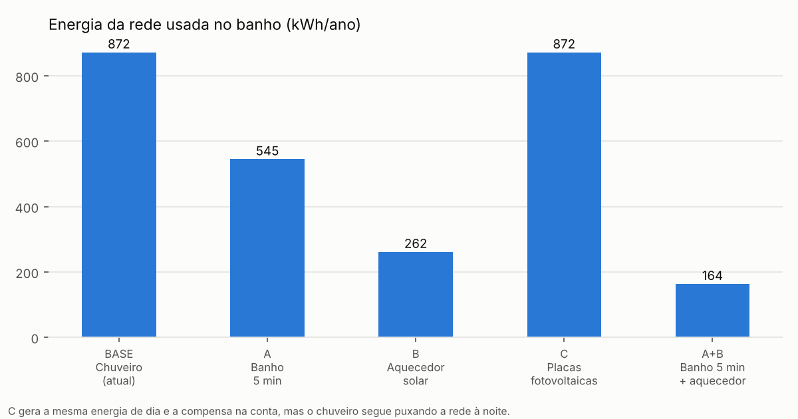

# Citizen Assist AI — Módulo de Energia: “Banho mais barato e sustentável”

> **Global Solution 2026.2 · Ciência da Computação (1CC)**
> **Contribuição da disciplina: Soluções em Energias Renováveis e Sustentáveis**

## Integrante

| Nome completo | RM |
|---|---|
| _Kayo Henderson_ | _570706_ |

## O problema e o público

**Público:** famílias de baixa renda da Grande São Paulo (área da Enel SP), muitas delas inscritas no CadÚnico e com direito à Tarifa Social.

**Necessidade energética:** aquecer a água do banho. O chuveiro elétrico costuma ser o **maior consumidor isolado de uma casa** (cerca de 24% do consumo residencial no Brasil, segundo a PPH Eletrobras/Procel) e liga justamente no **horário de pico (18h–21h)**. Para a família-tipo deste estudo (4 pessoas, banhos de 8 min, chuveiro de 5.500 W), ele responde por **~73 kWh/mês, cerca de 36% da conta** e **~R$ 830 por ano**.

**Como o assistente ajuda:** o cidadão pergunta em linguagem simples (“quanto meu chuveiro gasta?”, “vale a pena aquecedor solar?”) e recebe uma orientação **calculada para o perfil dele**, com os números que a sustentam, as **fontes** e os **limites** da estimativa. Detalhes em [docs/01_contexto.md](docs/01_contexto.md).

## Funcionalidades de energia

1. **Diagnóstico do banho** (menu 1) — calcula kWh/mês, R$/mês e participação na conta (E = P × t), com conferência física pelo calor da água (Q = m·c·ΔT).
2. **Comparação de alternativas** para a mesma necessidade e o mesmo período (12 meses; finanças em 15 anos):
   - **A** – Banho consciente (5 min), sem custo;
   - **B** – **Aquecedor solar de água** (fonte renovável) com o chuveiro como apoio;
   - **C** – **Placas fotovoltaicas** (fonte renovável) dimensionadas para o banho;
   - **A+B** – combinação recomendada.
3. **Custos, viabilidade e impactos** — investimento, economia, retorno simples e descontado, VPL, CO₂ evitado, alívio no horário de pico, água economizada, área de telhado.
4. **Tarifa Social** — considera a gratuidade dos primeiros 80 kWh/mês (Lei 15.235/2025) no cálculo da economia.
5. **Personalização** — pelo formulário do menu 10 ou digitando “somos 3 pessoas, banho de 10 minutos, chuveiro 7500 W, tarifa R$ 1,05, tenho tarifa social”; todas as contas são refeitas e o assistente avisa se os dados ficarem incoerentes.
6. **Fontes e limites em toda resposta** — nenhuma estimativa é apresentada como garantida.

## Principais resultados (perfil-base)

| Alternativa | kWh/ano da rede | Economia 1º ano | Investimento | Retorno simples | VPL 15 anos | Alívio no pico |
|---|---:|---:|---:|---:|---:|---:|
| Situação atual | 872 | — | — | — | — | — |
| A – Banho de 5 min | 545 | R$ 311 | R$ 0 | imediato | R$ 3.578 | 0 kW |
| B – Aquecedor solar | 262 | R$ 581 | R$ 4.500 | 7,6 anos | R$ 1.323 | 3,8 kW |
| C – Fotovoltaica | 872* | R$ 691 | R$ 5.000 | 7,2 anos | R$ 1.831 | 0 kW |
| **A+B – Recomendada** | **164** | **R$ 675** | **R$ 4.500** | **6,6 anos** | **R$ 2.397** | **3,8 kW** |

\* A FV gera ~872 kWh/ano de dia e compensa na conta, mas o chuveiro continua usando a rede à noite.

**Recomendação:** começar já pelo banho consciente (custo zero, −38% de energia e 17,5 mil litros de água/ano). Havendo telhado adequado e recursos ou programa de apoio, o **aquecedor solar** é a opção renovável que melhor resolve *esta* necessidade: tem retorno parecido com o da FV, mas também **tira o chuveiro do horário de pico**, enquanto a FV não alivia o pico noturno e quase não reduz CO₂ numa rede já limpa como a brasileira. Justificativa completa em [docs/04_comparacao_e_justificativas.md](docs/04_comparacao_e_justificativas.md).



## Como executar

Tudo roda **no terminal ou no IDLE**, só com a biblioteca padrão do Python 3.10+. Não há site nem nada para instalar.

**No IDLE (mais fácil):**
1. Baixe o repositório (botão verde *Code → Download ZIP*) e extraia.
2. Abra o IDLE → *File → Open* → escolha **`main.py`**.
3. Aperte **F5**. O menu aparece na janela do IDLE.

**No terminal:**

```bash
git clone https://github.com/kayoxshenderson-droid/gs-energia-renovavel.git
cd gs-energia-renovavel
python main.py                      # assistente com menu
python tests/test_energia.py        # testes automáticos (também pela opção 13 do menu)
python scripts/gerar_relatorio.py   # recalcula tabelas e CSVs (gráficos PNG só se houver matplotlib)
```

**Menu do assistente:**

```
 1. Quanto o chuveiro gasta?            7. Impacto ambiental
 2. Dicas para economizar (sem custo)   8. Fontes dos dados
 3. Vale a pena aquecedor solar?        9. Limites das estimativas
 4. Vale a pena placa fotovoltaica?    10. Ajustar MEU PERFIL
 5. Comparar todas as opções           11. Relatório completo + sensibilidade
 6. Tarifa Social                      12. Ver meu perfil
 0. Sair                               13. Rodar os testes automáticos
 Ou digite uma pergunta (ex.: "somos 3 pessoas, banho de 10 minutos")
```

Na opção **10** o assistente pergunta pessoas, minutos de banho, potência do chuveiro, consumo da conta, tarifa e Tarifa Social (Enter mantém o valor atual), e todas as respostas passam a usar o seu perfil. A opção **11** mostra a tabela comparativa, um gráfico de barras em texto e a análise de sensibilidade.

Perguntas livres para testar: “Quanto o chuveiro gasta por mês?”, “Como economizar no banho?”, “Vale a pena um aquecedor solar?”, “E placa solar?”, “Compare as opções”, “Como funciona a Tarifa Social?”, “Qual o impacto ambiental?”, “Quais as fontes?”, “Isso é garantido?”.

## Estrutura do repositório

```
├── main.py                     # >>> ABRA ESTE NO IDLE E APERTE F5 <<<
├── src/energia/
│   ├── premissas.py            # leitura das premissas
│   ├── calculos.py             # fórmulas de energia, tarifa, solar, finanças e CO2
│   ├── comparacao.py           # comparação das alternativas (mesma necessidade/período)
│   └── assistente.py           # intenções, respostas, fontes e limites
├── data/
│   ├── premissas.json          # TODOS os dados, com unidade, tipo (REAL/PÚBLICO/ESTIMADO) e fonte
│   ├── resultados_alternativas.csv
│   └── sensibilidade.csv
├── scripts/gerar_relatorio.py  # gera resultados, CSVs e gráficos
├── tests/test_energia.py       # 18 testes automáticos (unittest, biblioteca padrão)
└── docs/
    ├── 01_contexto.md                    # público, necessidade e papel do assistente
    ├── 02_dados_e_premissas.md           # origem, unidades, período e premissas
    ├── 03_resultados_gerados.md          # cálculos e tabelas (gerado por script)
    ├── 04_comparacao_e_justificativas.md # custos, viabilidade, impactos e recomendação
    ├── 05_referencias.md                 # fontes verificáveis com links
    ├── 06_limitacoes.md                  # condições e limites das estimativas
    ├── 07_testes_com_usuarios.md         # protocolo, registros e ajustes
    ├── 08_roteiro_video.md               # roteiro do vídeo de 3 minutos
    └── 09_uso_de_ia.md                   # declaração de uso de IA e verificação
```

## Integração com o Citizen Assist AI

O módulo é um pacote Python independente (`src/energia`), usado pelo `main.py`. Qualquer outra parte do Citizen Assist AI pode usar a mesma lógica chamando:

```python
from energia.assistente import AssistenteEnergia
bot = AssistenteEnergia()
resposta = bot.responder("vale a pena aquecedor solar?")
```

As respostas são **geradas a partir da mesma análise** (`comparacao.comparar`) documentada em `docs/`; os testes garantem que o número dito ao usuário é o número calculado.

## Referências e limitações

Fontes em [docs/05_referencias.md](docs/05_referencias.md) e limites em [docs/06_limitacoes.md](docs/06_limitacoes.md). **Todos os valores são estimativas para um perfil típico, não resultados garantidos.**
