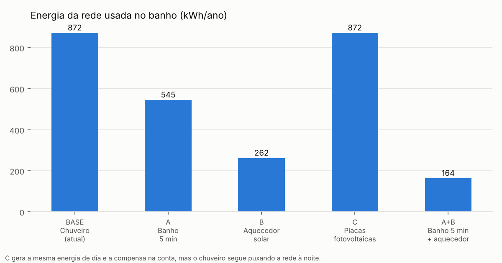
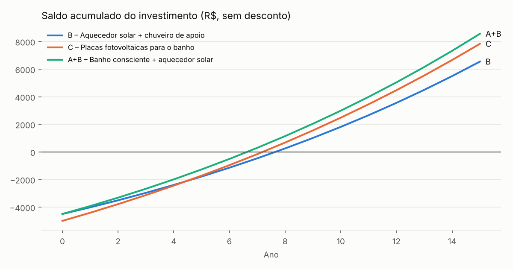

# Resultados gerados automaticamente

> Arquivo gerado por `python scripts/gerar_relatorio.py` a partir de `data/premissas.json`. Não editar à mão: altere as premissas e rode o script de novo.

## Consumo atual (alternativa BASE)

- Potência média anual do chuveiro: **4.542 W** (7 meses a 5.500 W + 5 meses a 3.200 W)
- Tempo de banho: **16,0 h/mês**
- Energia do chuveiro: **72,7 kWh/mês = 872 kWh/ano**
- Participação no consumo da casa: **36%**
- Tarifa estimada com tributos: **R$ 0,95/kWh**
- Custo anual do banho: **R$ 830,60**
- Emissões associadas: **33,6 kg CO₂/ano**
- Verificação física (posição inverno, 4 L/min): elevação de **18,7 °C**, 128 L/dia, 2,93 kWh/dia

## Comparação das alternativas (mesma necessidade, 12 meses; finanças em 15 anos)

| Alternativa | Renovável | kWh/ano da rede | Economia 1º ano | Investimento | Retorno simples (anos) | Retorno descontado (anos) | VPL 15 anos | CO₂ evitado (kg/ano) | Alívio no pico (kW) | Telhado (m²) |
|---|---|---:|---:|---:|---:|---:|---:|---:|---:|---:|
| BASE – Situação atual (chuveiro elétrico) | não | 872 | R$ 0,00 | R$ 0,00 | - | - | R$ 0,00 | 0,0 | 0,0 | 0,0 |
| A – Banho consciente (5 min) | não | 545 | R$ 311,47 | R$ 0,00 | 0 (imediato) | 0 (imediato) | R$ 3.578,16 | 12,6 | 0,0 | 0,0 |
| B – Aquecedor solar + chuveiro de apoio | sim | 262 | R$ 581,42 | R$ 4.500,00 | 7,6 | 11,1 | R$ 1.323,29 | 23,5 | 3,8 | 2,0 |
| C – Placas fotovoltaicas para o banho | sim | 872 | R$ 691,06 | R$ 5.000,00 | 7,2 | 10,3 | R$ 1.831,03 | -2,2 | 0,0 | 3,5 |
| A+B – Banho consciente + aquecedor solar | sim | 164 | R$ 674,86 | R$ 4.500,00 | 6,6 | 9,2 | R$ 2.396,74 | 27,3 | 3,8 | 2,0 |

- Fração solar efetiva do aquecedor: 70% (potencial do coletor 1.150 kWh/ano ≥ demanda térmica 828 kWh/ano)
- Sistema FV dimensionado: 0,71 kWp; cada kWh compensado vale 83% da tarifa (Lei 14.300/2022, Fio B 2026)
- Água economizada com banho de 5 min: 17.520 L/ano

## Análise de sensibilidade

| Cenário | Economia A (R$/ano) | Retorno B (anos) | VPL B 15a | Retorno C (anos) | VPL C 15a | Retorno A+B (anos) |
|---|---:|---:|---:|---:|---:|---:|
| Cenário base | R$ 311,47 | 7,6 | R$ 1.323,29 | 7,2 | R$ 1.831,03 | 6,6 |
| Tarifa R$ 0,80/kWh | R$ 261,60 | 9,0 | R$ 253,79 | 8,5 | R$ 600,18 | 7,8 |
| Tarifa R$ 1,20/kWh | R$ 392,40 | 6,1 | R$ 3.058,66 | 5,8 | R$ 3.828,24 | 5,3 |
| Aquecedor solar R$ 3.000 | R$ 311,47 | 5,4 | R$ 2.823,29 | 7,2 | R$ 1.831,03 | 4,7 |
| Aquecedor solar R$ 8.000 | R$ 311,47 | 11,9 | -R$ 2.176,71 | 7,2 | R$ 1.831,03 | 10,5 |
| FV custo mínimo R$ 7.000 | R$ 311,47 | 7,6 | R$ 1.323,29 | 9,5 | -R$ 168,97 | 6,6 |
| Fração solar 55% | R$ 311,47 | 9,6 | -R$ 107,98 | 7,2 | R$ 1.831,03 | 7,5 |
| Irradiação 4,0 kWh/m².dia | R$ 311,47 | 7,6 | R$ 1.323,29 | 7,2 | R$ 1.831,03 | 6,6 |
| 2 pessoas | R$ 155,74 | 14,4 | -R$ 2.016,33 | 13,7 | -R$ 2.012,46 | 12,7 |
| 6 pessoas | R$ 467,21 | 5,2 | R$ 4.662,90 | 4,9 | R$ 5.674,52 | 4,5 |
| Banho de 12 min | R$ 726,77 | 5,2 | R$ 4.662,90 | 4,9 | R$ 5.674,52 | 4,2 |
| Tarifa sobe 0%/ano | R$ 311,47 | 9,3 | -R$ 379,31 | 8,7 | -R$ 103,17 | 7,8 |

